# TrackCast: Forecasting Cascading Train Delays and Schedule Recovery

**Project report**: Data Science Fundamentals, National Institute of Technology Warangal
**Abhay Nagesh Rao**, Roll No. 26CSM1R01

> **Sources for the numbers in this report.** Every result is quoted from a file in [`reports/`](../reports/),
> cited in square brackets, e.g. [models.md]. Design parameters (thresholds, caps, dates) come from
> [`src/trackcast/config.py`](../src/trackcast/config.py) and are cited as [config]. A claim that cannot be traced to
> either is marked **⚑** and listed in [Appendix A](#appendix-a-claims-not-traceable-to-reports). Explanations of
> *why* something happens are labelled *interpretation* when the data does not test them.

---

## 1 Introduction

A timetable says when a train should arrive. It does not say whether the train will be on time, how a delay
at one station will spread down the line, or which junctions absorb lost time. TrackCast models
**station-level arrival delay** from the train's own recent delays and its context, so that delays and
recovery can be predicted per stop.

The proposal set four objectives. This report answers each one, and Section 8 summarises the answers:

1. quantify how upstream station delays propagate to downstream halts;
2. distinguish punctual or minor delays from severe cascading disruptions;
3. describe how weather, route congestion and junction buffer times affect delay recovery;
4. summarise route bottlenecks in plain terms.

**What was built.** A reproducible pipeline over one year of Indian Railways delay records (36.5 million
scheduled stops [data_quality.md]): cleaning, leak-free lag and slack features, a two-stage hurdle model,
descriptive delay and route profiles, an exploratory analysis, results per train class and route, a
bottleneck ranking, and a Streamlit application that forecasts a train's delay at every remaining stop. The
system is described in [ARCHITECTURE.md](ARCHITECTURE.md).

**Headline result.** On the held-out winter months (December 2025 to February 2026, 996,417 test stops), the
hurdle model's RMSLE is 0.6355 against 0.9517 for "the delay at the previous stop carries over"
(persistence). That is a skill of 33.2% [33.0, 33.4]. Mean absolute error falls from 8.30 to 6.83 minutes,
and Stage 1 F1 rises from 0.887 to 0.913 [models.md, results.md].

---

## 2 Proposed Solution (as implemented)

The proposal's pipeline (raw telemetry → cleaning → lag & slack features → two-stage hurdle ML → delay &
route profiles) was built as planned. An evaluation layer, a route forecast and a serving layer sit on top:

```
 raw CSVs ──► cleaning ──► lag & slack ──► two-stage ──► per-class / per-route results
 (Kaggle)     data.py      features        hurdle ML     results.py
                           features.py     train.py         ▲
                 │                             │            │
                 └──► delay & route profiles ──┴──► exploratory analysis ──► bottleneck ranking
                      profiles.py                    eda.py                   results.py
                                               │
                     route forecast (recursive)┴──► Streamlit app (app/) via serving.py
                     forecast.py
```

### 2.1 Data preprocessing

The proposal planned to remove cancelled services, records without valid arrival timestamps and
corrupted logs with negative distances or impossible speeds. The dataset (Section 3) gives the delay in
minutes directly, with no actual timestamps and no cancellation flag, so each rule was adapted:

| Proposal rule | What the data allowed | Effect [data_quality.md] |
|---|---|---|
| Delay_k = actual − scheduled (eq. 1) | Delay is already given per stop; used directly | – |
| Truncate at zero | `delay` clipped at 0; the raw value is kept as `delay_raw` for profiles | 760,141 negative delays clipped (2.0% of raw rows were negative; median −10 min) |
| Remove invalid records | Delays above 24 h treated as recording errors and set to missing | 14,899 rows (raw maximum 525,592 min) |
| Missing arrivals | Missing delays stay missing (NaN), never 0, which would make trains look punctual | 1.30% missing after cleaning (4.88% raw) |
| Cancelled services | No flag exists. Runs with fewer than 3 observed delays are dropped (velocity needs k−1 and k−2) | 54,784 runs, 632,921 rows |
| Impossible speeds | No actual times, so actual speeds cannot be computed. The analogues: the 24-h rule above, and the "sawtooth" timetable-error flag (Section 4.1) | 112 stations flagged [results.json] |

Two findings from cleaning shaped the rest of the project:

- **Join key.** Joining delays to the timetable on `(train_no, station_no)` attached the wrong stop's
  schedule wherever the two files number stops differently. The join uses `(train_no, station_name)`
  (unique per train in both files), and the timetable's stop number becomes the stop order. 6,634,445 rows
  had their stop number renumbered to the timetable's, and 40,277 rows are in a different order from it
  [data_quality.md].
- **What a run is.** A run is `(train_no, date)`, which is only valid if `date` is the run's *start* date. Two
  independent tests confirmed it. (A) Weekday consistency: 1,704 non-daily multi-day trains were consistent
  only with the start date, 0 only with the calendar date. (B) Delay continuity across midnight: correlation
  0.946 when pairing within the same `date` vs 0.562 with `date + 1`, and a median jump of 8 vs 16 min
  [data_quality.md]. The build stops if the verdict is ever the calendar date.

The 1 GB CSV is streamed in two passes. Pass 1 splits it into monthly files. Pass 2 cleans one month at a time,
because a run never spans two `date` months. Every step writes a typed Parquet table. A development
sample of 99,999 rows from 4,988 whole runs is drawn by run, never by row, so stop sequences stay intact
[data_quality.md].

### 2.2 Lag and schedule feature engineering

Each model row is one stop k of one run, with 32 numeric and 3 categorical features [features.md]:

| Proposal measure | Implemented as |
|---|---|
| Upstream lag L_{k−1} | `lag1`: the delay at the last **observed** stop before k. A missing stop is skipped, never read as 0. Staleness features say how far back it is (`lag_stops_back`, `lag_sched_min_back`). Only 0.87% of rows take the lag from further back than the previous stop. |
| Delay velocity ΔL_k | `delay_velocity = lag1 − lag2` (`lag2` missing in 5.34% of rows, left as NaN). |
| Schedule slack S_k | `slack_since_lag`: scheduled time between the lag stop and k beyond the minimum. Run slack is a train's scheduled time on a station pair minus the fastest train scheduled on that pair. Dwell slack is the scheduled dwell minus the shortest dwell at that station. Both come from the timetable only. |
| Cyclical time | sin/cos of the **scheduled** hour, day of week (of the stop's own calendar date) and month. |
| Weather indicators | No weather columns and no station coordinates exist, so season flags are used instead: `fog_season` (Dec–Feb in zones NR, NCR, NER, NWR, ECR, ER), `fog_night` (the same, 21:00–10:00), `monsoon` (Jun–Sep) [config]. |
| Route congestion | `station_trains_hour` / `station_trains_day`: trains scheduled at the station in that clock hour / that day. |
| Station codes | Kept raw here and target-encoded inside the model pipeline (Section 2.4). |

**The leakage rule.** A row for stop k may use delays observed at stops ≤ k − 1 of the same run, plus the
timetable (published in advance). It may not use the delay at k or later, the *actual* time at k, or any
statistic fitted on delays across runs. A property test randomly changes or blanks every delay at stops ≥ k
and requires every feature of stop k to stay bit-for-bit unchanged.

**What the features showed** (34,195,522 model rows, 52.57% late > 15 min) [features.md]:

- **Persistence is a strong baseline.** Predicting delay_k = lag1 gives RMSLE 0.969, R² 0.596 on log1p and
  F1 0.876 for "late". A high R² on its own would therefore say little, so every model is judged by its gain
  over persistence.
- **Slack absorbs delay.** Among trains already late, the share that recover by stop k grows with the slack in
  between:

  | Slack since lag stop (min) | 0 | (0,2] | (2,5] | (5,10] | (10,20] | (20,40] | >40 |
  |---|---:|---:|---:|---:|---:|---:|---:|
  | Mean change in delay (min) | +0.58 | +1.21 | +2.08 | +1.06 | −2.45 | −11.97 | −28.54 |
  | % recovered | 30.9 | 32.0 | 38.4 | 48.6 | 60.3 | 76.1 | 86.2 |

  Slack's own rank correlation with log1p(delay) is near 0 (0.026). It acts on the *change* in delay, not on its
  level, which is why the linear models get an explicit lag × slack interaction.

### 2.3 Exploratory analysis

The four views the proposal named are all in [eda.md] and the figures in [`reports/figures/`](../reports/figures/).

**Raw and log-transformed delay.** 36,025,806 observed arrivals: mean 36.1 min, median 16, p99 309; 15.3%
exactly on time, 50.6% late, 3.1% more than 3 h late. Skewness falls from 6.14 in minutes to −0.24 after
log1p. This supports both modelling choices: a log1p target scored with RMSLE, and a separate stage for the
on-time spike [eda.md].

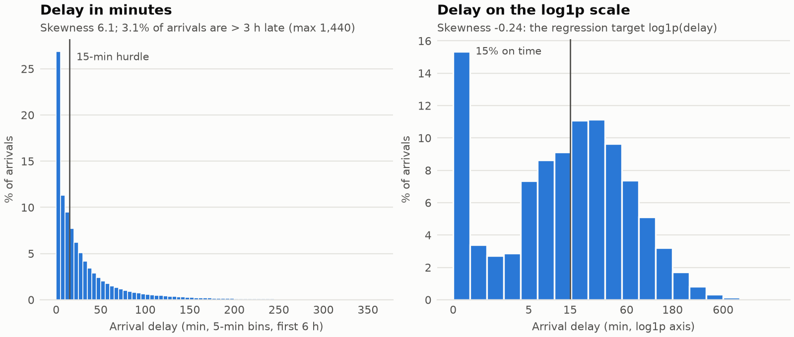

**Cascading trajectories.** Delay builds along a route, and a late train rarely catches up. 20 observed stops
after a stop, by the delay there [eda.md, profiles.md]:

| Initial delay | Pairs | Mean delay gained after 20 stops (min) | % still late |
|---|---:|---:|---:|
| ≤ 15 min | 4,175,547 | +27.2 | 53.4 (became late) |
| 15–60 | 2,911,236 | +16.4 | 68.2 |
| 60–180 | 1,076,438 | +12.5 | 89.4 |
| > 180 | 235,498 | +34.7 | 99.0 |

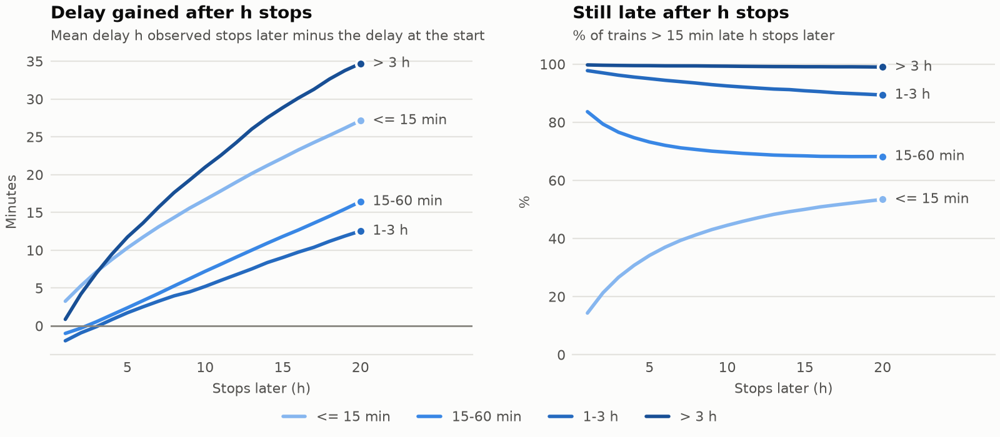

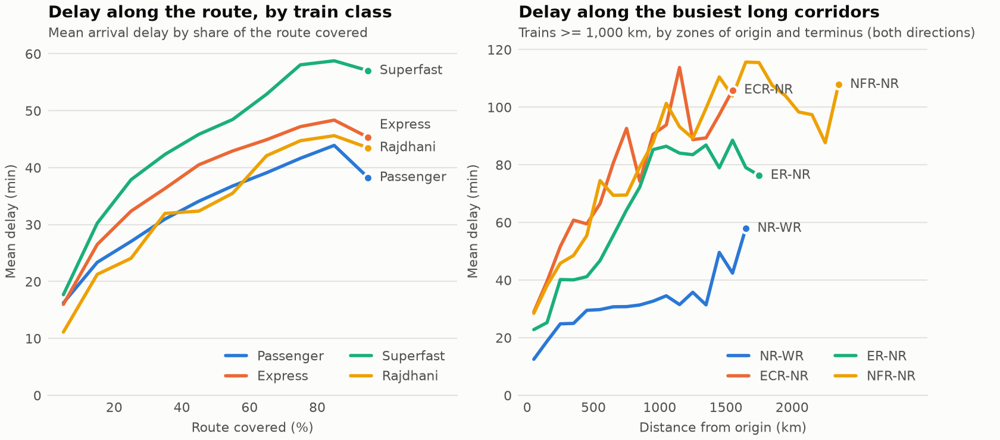

The same train varies a lot from run to run. Train 22503 (DBRG Vivek Express, 365 runs) starts with a
median delay of 0 min and reaches Dibrugarh with a median of 95.5 min, but its p10–p90 range there is 0–348.7 min
[eda.md]. The run's own upstream delay matters far more than the train's average.

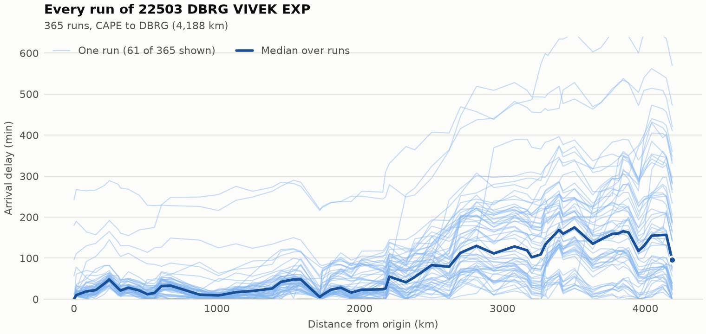

**Seasonal slowdowns.** Fog: fog-prone zones are 12.7 min worse in Dec–Feb than in Mar–Nov, other zones
5.1 min worse. That makes a difference-in-differences of **+7.6 min**, and +0.63 min more delay gained per
arrival. Within fog-prone zones the winter uplift is 4.5 min larger for arrivals scheduled 21:00–10:00 than
in daytime (+15.1 vs +10.5) [eda.md].
**Monsoon: no slowdown.** Mean delay is 32.78 min in Jun–Sep vs 35.01 in the dry months. Most zones are better
in the monsoon (ECR −8.12, NER −7.59), and only Konkan Railway is worse (+1.4) [eda.md].

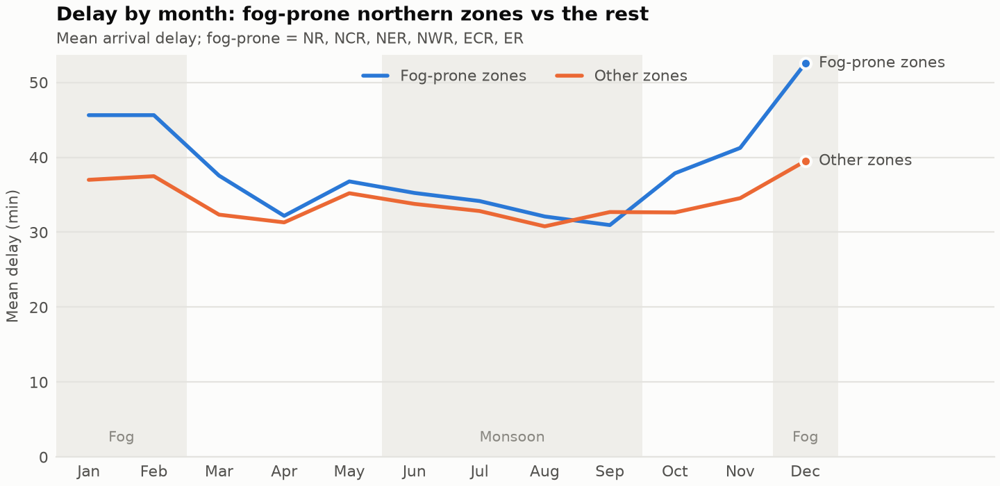

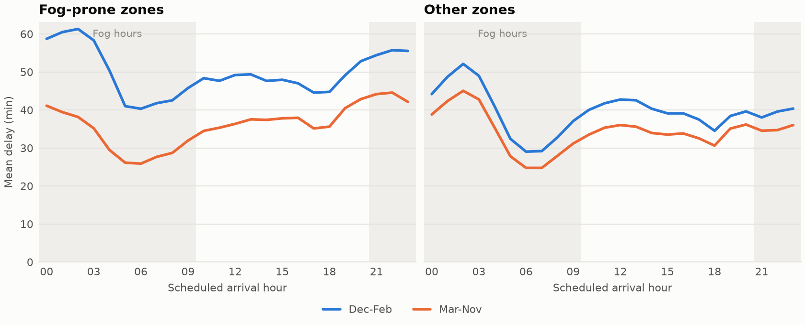

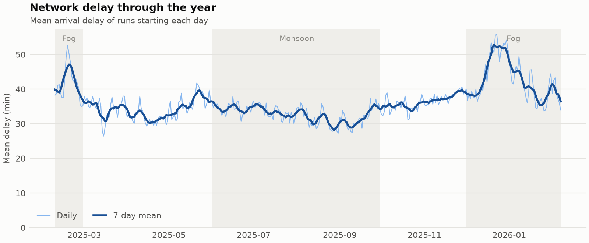

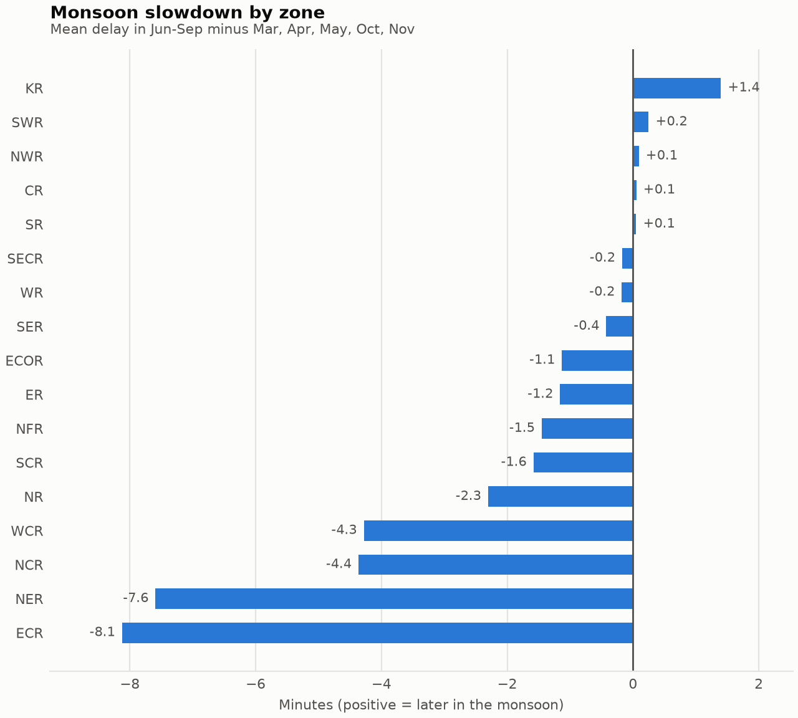

**Schedule recovery at junctions vs minor halts** (recovery = % of late arrivals whose delay falls on
arrival). Junctions recover 57.5%, major stations 53.8%, minor halts 37.4%. A late train *loses* time at
minor halts on average (+0.25 min). The junction effect is not just traffic: in the busiest traffic quintile
junctions recover 58.2% vs 42.1% for other stations, while at mid traffic they are about level (37.0% vs
35.5%) [eda.md]. Section 4.6 revises the junction figure using trains passing *through*.

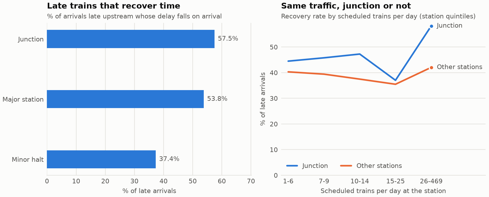

**Congestion.** For passenger and express trains, mean delay change *falls* as scheduled traffic rises
(passenger: +0.94 min at 1 train/h, −6.35 at 16+). For Rajdhani it rises (−0.73 to +5.95) [eda.md]. Busy
stations are also the big stations with recovery allowances, so this is an association, not the effect of one
extra train.

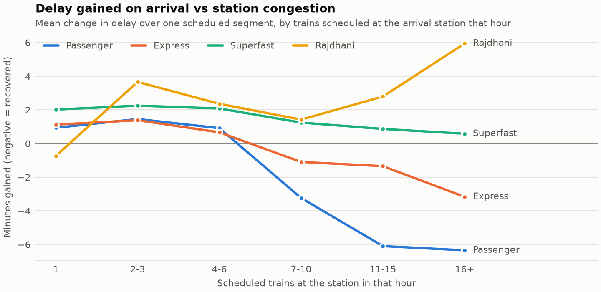

### 2.4 Two-stage hurdle modelling

```
 Stage 1   p = P(delay_k > 15 min)             LogisticRegression | RandomForest, then isotonic calibration
 Stage 2   m_late = E[log1p delay | late]       Ridge | HistGradientBoosting, fitted on late rows
           m_low  = E[log1p delay | not late]   same family, fitted on the other rows
 Hurdle    E[log1p delay] = p · m_late + (1 − p) · m_low
```

- **Preprocessing per family.** Linear models get log terms, a lateness flag, the log(lag1) × log(slack)
  interaction, median imputation with missing indicators, and standardisation. RandomForest gets imputation.
  HistGradientBoosting handles NaN natively. Station code and train number are target-encoded; train type and zone
  are one-hot encoded.
- **Target encoding inside the folds, grouped by date.** sklearn's `TargetEncoder` cross-fits with random-row
  folds. That would encode a row from later stops of *its own run* and from same-day trains, giving training
  rows an encoding no test row gets. `GroupedTargetEncoder` groups those folds by run date. It sits inside the
  pipeline, so it is refitted on every CV fold's training rows.
- **Stage 2 learns the residual over persistence.** Each regressor fits log1p(delay_k) − log1p(lag1) and adds
  log1p(lag1) back, so a tree leaf only has to learn the gain or recovery, not the level. ⚑ *The ablation that
  motivated this (direct HGB dev RMSLE 0.703 → 0.684) was run on the dev sample and is recorded only in
  INTERVIEW_NOTES.md, Phase 3.*
- **Calibration.** The hurdle mixes the two parts in log space, so a miscalibrated p is costly: a train hours
  late with p = 0.97 gets 3% weight on an on-time forecast. Isotonic calibration is fitted on out-of-fold CV
  predictions. On the test set it lowered the RF's log loss from 0.2478 to 0.2414 and kept F1 (0.9125 → 0.9133)
  [models.md]. ⚑ *The dev-sample diagnosis behind it (median P(late) 0.973 for trains > 3 h late; MAE for them
  47.7 → 29.2 min) is recorded only in INTERVIEW_NOTES.md, Phase 3.*
- **Selection metric.** Classifiers are tuned on log loss (a proper scoring rule, because p feeds the hurdle).
  F1 uses a threshold tuned on the CV months. Regressors are tuned on RMSE of log1p within their part.

**Tuning grid and choices** (mean over the three CV folds) [models.md]:

| Family | Part | Chosen | CV score |
|---|---|---|---:|
| LogisticRegression | classifier | C = 0.1 (all C equal) | log loss 0.2823 |
| RandomForest | classifier | min_samples_leaf = 5 | log loss 0.2503 |
| Ridge | late / low | alpha 0.1 / 100 (all alpha equal) | RMSE 0.3274 / 0.7613 |
| HistGradientBoosting | late / low / direct | max_leaf_nodes 127, min_samples_leaf 100 | RMSE 0.2218 / 0.6387 / 0.6199 |

CV picked **RandomForest + HistGradientBoosting** as the hurdle pair, with Stage 1 thresholds 0.458 (RF) and
0.453 (LogReg) [models.md].

### 2.5 Profiling and evaluation

**Evaluation protocol** [models.md, config]:
- **Split by date.** Train on runs starting 2025-02-08 to 2025-11-27, test on runs starting 2025-12-01 to
  2026-02-07, with a 3-day embargo before the cutoff so multi-day runs do not straddle it. A random-row split
  would put stops of the same run on both sides.
- **Sampling.** Training uses 999,274 rows / 53,785 runs and testing 996,417 rows / 52,968 runs, both sampled by
  whole run to fit laptop memory (3.6% and 15.6% of their periods). The test period is later than training and
  has more late stops (57.89% vs 51.09%).
- **Forward-chaining CV** inside the training period. 2025-09, 2025-10 and 2025-11 each validate once on an
  expanding window (fit 682,843 / 788,847 / 895,514 rows). It picks the hyper-parameters, threshold,
  calibration and model pair. The test months are scored once.
- **Baselines.** Persistence (delay_k = lag1) and persistence minus the scheduled slack.
- **Uncertainty.** A day-block bootstrap over the 69 test days. Errors on one day are correlated, so a row
  bootstrap would be too narrow.
- **Metrics.** F1 (Stage 1), RMSLE and R² on log1p (Stage 2 and hurdle), and MAE in minutes for readability.
- **Stability and importance.** CV standard deviations, agreement between the CV ranking and the test ranking,
  and permutation importance with correlated columns shuffled together as groups.

**Profile metrics** (the proposal's "mean arrival delay, schedule recovery rate, and congestion
sensitivity" per corridor and train class) [eda.md, results.md]:
- *recovery rate*: % of arrivals late (> 15 min) at the previous stop whose delay falls on arrival;
- *congestion sensitivity*: least-squares slope of the one-segment delay change on the trains scheduled at the
  arrival station that hour, in minutes per +10 trains/h;
- *corridor*: the zones of origin and terminus as an unordered pair ("ER-NR"), so both directions are one
  corridor.

### 2.6 Interactive exploration

A Streamlit application presents the forecasts, profiles and bottleneck results (Section 5).

---

## 3 Dataset Details

The proposal named the Indian Railways Operational Delay Dataset alongside NJ Transit / Amtrak telemetry,
with weather and congestion attributes per row. The project uses the Kaggle dataset
**rxydenxd/indian-railways-delay-dataset** (MIT licence). It has per-train, per-day, per-station delays, which
the cascade features need. It has no weather, congestion or actual-time columns, and no US data was used.

**Table 1: Dataset as used** [data_quality.md, profiles.md]

| Attribute | Value |
|---|---|
| Source | Kaggle `rxydenxd/indian-railways-delay-dataset` (MIT) |
| Files | `combined_delay.csv` (date, station_no, station_name, delay, train_no), `combined_schedule.csv` (timetable with arrival/departure day and time, distance), `train_details.csv` (name, type), `station_full_names.csv` (name, zone, address) |
| Records | 38,428,703 raw stop records → **36,500,515 clean** (1,830,284 runs) |
| Period | 2025-02-08 to 2026-02-07 (one year) |
| Coverage | 6,908 trains, 8,142 stations, 29,502 station pairs |
| Timetable | 172,112 rows for 8,673 trains |
| Fields used | train number and type, station code and zone, stop sequence, distance, scheduled arrival / departure, delay (minutes) |
| Not available | actual times, weather, congestion, cancellations, station coordinates, running days |

**Row waterfall** [data_quality.md]:

| Step | Rows |
|---|---:|
| raw rows | 38,428,703 |
| valid keys, date, no duplicates | 38,428,703 |
| matched to the timetable | 37,133,436 |
| runs with ≥ 3 observed delays (final) | 36,500,515 |

Data quality over time: missingness falls from 2.39% in February 2025 to 0.38% in January 2026
[data_quality.md], so data collection improved during the year. 1,571,428 of the 1,830,284 runs fall in the top
coverage bucket (observed delays / scheduled stops = 1.0). As the proposal allowed, all development ran on the
~100k-row sample. Every number in this report comes from the full-year (`--full`) runs.

---

## 4 Results

### 4.1 Delay and route profiles

Descriptive statistics over all 36.5M stops [profiles.md]:

- **Network.** Mean arrival delay 36.05 min, and 50.59% of arrivals late > 15 min.
- **Calendar.** December (45.3 min) and January (40.85) are the worst months, August (31.38) and September
  (31.91) the best. Arrivals scheduled 00:00–03:00 average 42.3–45.5 min, those at 05:00–07:00 27.4–29.3 min.
  Day of week barely matters (35.59–36.53 min).
- **Train types** (mean terminus delay / delay gained en route). Premium specials (PRM, mostly Humsafar)
  133.46 / 99.94 min, Garib Rath 53.44 / 39.91, Superfast 41.47 / 32.33, Vande Bharat 11.82 / 7.48.
  *Interpretation:* specials may get lower path priority than regular services. The data cannot show this.
- **Stations.** The highest mean delays cluster in South Eastern Railway's Chakradharpur area: MOU 142.1, SWR
  133.49, GOL 132.41 and CKP 130.92 min. On the CKP→TATA segment late trains lose 79.68 min on average
  against 56.82 scheduled minutes.
- **Suspected timetable errors ("sawtooth" stations).** Some stations show a large recovery on arrival that
  the next segment undoes, e.g. MDKU −43.11 min on arrival and +51.19 on the next segment. The recorded delay
  there is systematically off. The likeliest cause (*interpretation*) is a wrong timetable time at that
  station. 67 of the 5,385 stations with ≥ 2,000 arrivals are flagged, and 264 ranked segments touch them. They
  are kept but left out of the change rankings [profiles.md]. Over all stations, including thinly observed
  ones, 112 are flagged, and Phase 7 drops every through-triple that touches one [results.md].

### 4.2 Model evaluation (test set, Dec 2025 – Feb 2026)

**Overall forecast of log1p(delay)** (996,417 test stops) [models.md]:

| Model | RMSLE | R² (log1p) | MAE (min) | Skill vs persistence |
|---|---:|---:|---:|---:|
| Persistence (delay_k = lag1) | 0.9517 | 0.5991 | 8.30 | 0.0% |
| Persistence minus slack | 1.0709 | 0.4924 | 8.87 | −12.5% |
| Direct Ridge (single stage) | 0.7449 | 0.7544 | 19.35 | 21.7% |
| Hurdle LogReg + Ridge | 0.7264 | 0.7665 | 16.24 | 23.7% |
| Hurdle RF + Ridge | 0.7036 | 0.7809 | 15.25 | 26.1% |
| Direct HGB (single stage) | **0.6153** | **0.8324** | 7.06 | **35.3%** |
| Hurdle LogReg + HGB | 0.6565 | 0.8093 | **6.82** | 31.0% |
| **Hurdle RF + HGB (selected)** | 0.6355 | 0.8212 | 6.83 | 33.2% |
| Hurdle with perfect Stage 1 (upper bound) | 0.4567 | 0.9077 | 5.21 | 52.0% |

Day-block bootstrap of the RMSLE difference over 69 test days [models.md]:
- persistence − selected = **+0.3161** [+0.3127, +0.3198]: the hurdle beats persistence;
- direct HGB − selected = **−0.0202** [−0.0217, −0.0187]: the single-stage HGB is reliably, though slightly,
  better on RMSLE.

**Why keep the hurdle?** It gives P(late) directly, its Stage 1 is the proposal's classification task, and it
is marginally better in minutes (MAE 6.83 vs 7.06). The perfect-Stage-1 bound (0.4567) shows that splitting
on lateness is valuable, but rows near the 15-min line get the wrong component when misclassified. The
single-stage HGB is the better pure magnitude forecaster. Both are reported.

**Stage 1 (late > 15 min)** [models.md]:

| Model | F1 | Precision | Recall | ROC-AUC | Log loss |
|---|---:|---:|---:|---:|---:|
| Persistence (lag1 > 15) | 0.8870 | 0.8947 | 0.8794 | – | – |
| LogReg, calibrated @ 0.453 | 0.9038 | 0.9145 | 0.8934 | 0.9510 | 0.2744 |
| **RF, calibrated @ 0.458** | **0.9133** | 0.9290 | 0.8981 | **0.9623** | **0.2414** |

**Stage 2 (given the true class)** [models.md]: on late rows, HGB reaches R² 0.9169 (RMSLE 0.2236, MAE
7.35 min) against persistence's R² 0.1775. On the other rows, R² is 0.5981 vs −0.3851.

**Where the model helps** [models.md]:

| lag1 (min) | Rows | RMSLE persistence | RMSLE selected | MAE persistence | MAE selected |
|---|---:|---:|---:|---:|---:|
| ≤ 15 | 429,413 | 1.1588 | 0.7615 | 5.71 | 4.61 |
| 15–60 | 373,639 | 0.8610 | 0.5754 | 8.50 | 6.24 |
| 60–180 | 154,638 | 0.5375 | 0.4073 | 12.63 | 10.05 |
| > 180 | 38,727 | 0.3287 | 0.3241 | **17.81** | 24.37 |

The gain is largest for small and moderate delays. For trains already more than 3 h late, persistence is
better in minutes. The log-scale loss treats 300 vs 330 min as a small error. The model is stable across the
three test months (RMSLE 0.6296, 0.6395, 0.6443).

**Feature-group importance** (RMSLE increase when a group is shuffled; std in brackets) [models.md]: cascade
1.2729 (0.0057) ≫ slack 0.1254 > station 0.1045 > route 0.0558 > congestion 0.0346 > train 0.0156 > time
0.0068 > season −0.0002. Fog shows up already in the upstream delay, so the season flags add nothing beyond it.

**Stability.** Fold-to-fold standard deviations are small (e.g. 0.0041 / 0.0033 for the chosen late / low HGB). The CV
ranking (direct HGB 0.6199, hurdle RF+HGB 0.6446, hurdle LogReg+HGB 0.6679, …, persistence 0.9728) matches
the test ranking [models.md], so the CV protocol was a reliable guide.

⚑ *Data size.* The dev-sample model (75k training rows) scored RMSLE 0.701, against 0.6355 for the 1M-row
model, which suggests more training rows would help further. The dev figure was overwritten in
`reports/models.md` by the full run and survives only in INTERVIEW_NOTES.md (Phase 3). The dev model's row
count (75,045) is in `demo/manifest.json`.

### 4.3 Results per train class

Skill = 100 × (1 − RMSLE hurdle / RMSLE persistence) on test stops, with a 95% day-block interval. The year
columns describe the class over the whole year [results.md].

| Class | Test stops | % late | Skill % [95% CI] | MAE persistence → hurdle | F1 persistence → hurdle | Year mean delay | Year % recover | Congestion slope (min / +10 trains/h) |
|---|---:|---:|---|---|---|---:|---:|---:|
| Passenger | 474,245 | 55.4 | 32.0 [31.6, 32.4] | 6.76 → 5.64 | 0.913 → 0.932 | 32.8 | 39.5 | −4.5 |
| Express | 364,250 | 60.3 | 33.3 [33.0, 33.7] | 8.93 → 7.16 | 0.875 → 0.904 | 37.5 | 44.7 | −2.7 |
| Superfast | 135,894 | 61.5 | 35.6 [35.3, 36.0] | 11.26 → 9.26 | 0.849 → 0.888 | 44.0 | 46.9 | −1.1 |
| Vande Bharat | 9,611 | 38.1 | **38.2** [37.0, 39.3] | 8.68 → 7.00 | 0.720 → 0.792 | 15.3 | 58.5 | −0.3 |
| Premium / special | 4,407 | 66.6 | 32.2 [29.8, 34.6] | 21.17 → **21.52** | 0.867 → 0.896 | 96.1 | 44.0 | +3.8 |
| Rajdhani | 3,138 | 55.4 | 31.3 [28.8, 33.9] | 16.70 → **17.55** | 0.794 → 0.835 | 32.4 | 59.0 | +1.9 |
| Shatabdi | 2,453 | 45.8 | 36.6 [34.4, 38.6] | 9.63 → 9.35 | 0.768 → 0.810 | 15.0 | 58.8 | −0.4 |
| Garib Rath | 2,419 | 59.8 | 35.6 [33.2, 38.2] | 14.35 → 11.71 | 0.818 → 0.865 | 52.5 | 45.8 | −1.9 |

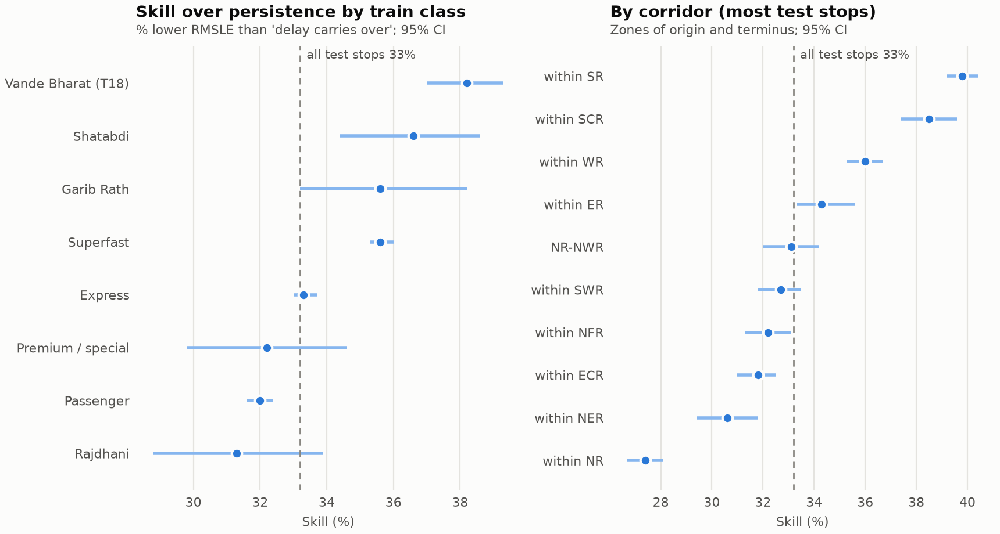

- **No class is left behind.** Skill is 31–38% for every class, and every interval is well above 0. Stage 1 F1
  improves in every class.
- **Highest skill: punctual premium trains** (Vande Bharat, Shatabdi). Their delays are small and noisy, so
  persistence's "3 min late stays 3 min late" is a large log-scale error when the train makes the time up.
- **In minutes, the hurdle is slightly worse for Premium specials and Rajdhani**, the classes most often hours
  late. This is the "> 3 h late" limitation of Section 4.2 showing up by class.
- **Profiles by class.** Rajdhani, Shatabdi and Vande Bharat recover about 59% of late arrivals vs 39.5% for
  passenger trains. Passenger and express trains recover at busy stations (negative slope), while Rajdhani
  and premium specials lose time there (positive slope) [eda.md]. *Interpretation:* busy stations have padded
  timetables that slow trains can use, while fast trains with tight paths are held up in crowded yards.

### 4.4 Results per route

**By corridor** (the 15 with the most test stops) [results.md]. Skill ranges from 24.6% (within ECOR) to 39.8%
(within SR):

| Corridor | Test stops | % late | Skill % [95% CI] | MAE persistence → hurdle | Year mean delay | Year % recover |
|---|---:|---:|---|---|---:|---:|
| within SR | 78,696 | 35.2 | **39.8** [39.2, 40.4] | 5.37 → 3.77 | 13.0 | 48.1 |
| within SCR | 46,510 | 64.1 | 38.5 [37.4, 39.6] | 12.06 → 8.26 | 37.5 | 42.4 |
| within WR | 50,441 | 30.7 | 36.0 [35.3, 36.7] | 4.59 → 3.60 | 11.2 | 54.1 |
| within ER | 40,237 | 43.4 | 34.3 [33.3, 35.6] | 4.29 → 3.70 | 18.6 | 35.2 |
| within CR | 19,689 | 55.6 | 34.2 [33.2, 35.3] | 7.66 → 5.65 | 25.6 | 43.0 |
| ECR-ER | 22,196 | 65.8 | 33.3 [31.8, 34.7] | 7.50 → 6.29 | 34.9 | 38.4 |
| NR-NWR | 28,168 | 58.7 | 33.1 [32.0, 34.2] | 6.37 → 5.90 | 24.7 | 41.5 |
| within SWR | 31,029 | 38.1 | 32.7 [31.8, 33.5] | 6.02 → 4.87 | 15.2 | 48.7 |
| within NFR | 31,065 | 65.1 | 32.2 [31.3, 33.1] | 8.16 → 6.46 | 30.4 | 41.9 |
| within ECR | 60,450 | 70.7 | 31.8 [31.0, 32.5] | 9.42 → 7.41 | 49.2 | 41.5 |
| within NER | 29,590 | 59.1 | 30.6 [29.4, 31.8] | 6.28 → 5.47 | 44.1 | 41.5 |
| within NWR | 24,906 | 41.8 | 30.3 [29.0, 31.6] | 4.47 → 3.91 | 14.8 | 43.6 |
| within NR | 68,858 | 62.6 | 27.4 [26.7, 28.1] | 6.27 → 5.87 | 31.9 | 34.4 |
| within SECR | 20,223 | 70.2 | 25.4 [23.9, 27.0] | 7.89 → 7.06 | 46.0 | 34.6 |
| within ECOR | 19,195 | 67.5 | 24.6 [23.0, 26.0] | 6.42 → 5.37 | 40.3 | 35.8 |

Skill tends to be lowest where trains are already late in the test months (within SECR 70.2% late, within ECOR
67.5%, within NR 62.6%) and is highest in mostly punctual zones (within SR 35.2% late, within WR 30.7%). The
pattern has exceptions: within SCR is 64.1% late with 38.5% skill. *Interpretation:* once a train is late the
delay mostly persists, so persistence is close to optimal there. The model earns its keep on small, volatile
delays and on recovery.


**By train** (859 trains with ≥ 300 test stops) [results.md]: median skill 31.4% (middle half 24.8–38.2%,
10th–90th percentile 18.0–44.6%). The hurdle has a higher RMSLE than persistence on 16 trains, and for 8 the
whole interval is below 0. They are mostly passenger trains, e.g. the BRWD–CAR passenger pair in both
directions (skill −26.5% and −25.1%). The largest gains are on volatile MEMU/DEMU and express services, e.g.
67259 BZA–BTTR MEMU, whose RMSLE falls from 2.272 to 1.117.

### 4.5 Multi-stop route forecasts

The model forecasts one stop ahead, so the app forecasts later stops recursively, feeding each forecast back
as the next stop's upstream delay. `python -m trackcast.forecast` simulates this on 1,500 test-period runs
[route_forecast.md]. Each starts at a random observed stop, only that delay is known, and the next 20 stops are
compared with what happened. The strategies differ in which minutes are fed forward:

| Stops ahead | Median (expm1 E[log]) | **Mean (used)** | Gate | Persistence | Cascade profile |
|---:|---:|---:|---:|---:|---:|
| 1 | 8.90 | 6.46 | 6.22 | **6.11** | 6.58 |
| 2 | 12.02 | **9.22** | 9.40 | 10.01 | 10.16 |
| 5 | 19.71 | **15.40** | 16.36 | 17.67 | 17.11 |
| 10 | 28.91 | **22.83** | 24.61 | 26.55 | 25.10 |
| 20 | 41.93 | **33.13** | 35.45 | 38.46 | 38.73 |

*MAE in minutes. Mean = P(late)·expm1(m_late) + (1 − P(late))·expm1(m_low).*

- The one-stop RMSLE-optimal forecast (median) chained 20 times shrinks a late train towards 0 (bias −39.45 min
  at 20 stops). The expected minutes (mean) is the most accurate from 2 stops ahead and has the best RMSLE from
  3 stops ahead (e.g. 1.09 vs 1.51 for persistence at 10 stops), so it is the app's default.
- Far-ahead forecasts still run low (mean-strategy bias −14.55 min at 10 stops). The cascade-profile baseline
  is nearly unbiased (−4.77) but less accurate per train. It also uses all dates, so it has seen the test
  months.
- With only one delay entered, the next-stop forecast is slightly worse than persistence (6.46 vs 6.11): lag2
  is missing, which the model rarely saw mid-route.

### 4.6 Schedule recovery through stations and bottleneck junctions

**Through-station change.** Delay change on arrival alone misleads at big stations: a train often "recovers" on
the padded approach and loses the time again leaving. For each train passing straight through a station
(previous, current and next stop all observed), the change from the stop before to the stop after is split into
arrival and departure [results.md]:

| Station class | Stations | Trains through | Arrival | Departure | Through (min) | % late that recover | % on time made late |
|---|---:|---:|---:|---:|---:|---:|---:|
| Junction | 358 | 4,433,267 | +1.2 | +1.8 | +3.0 | 52.8 | 28.7 |
| Major station | 141 | 2,808,244 | +1.8 | +2.0 | +3.8 | 51.6 | 32.7 |
| Minor halt | 7,304 | 23,955,832 | +1.8 | +0.4 | +2.2 | 42.5 | 18.3 |

On through traffic, junction recovery is 52.8%, not the 57.5% measured on arrival (Section 2.3). Big stations
recover more late trains, but they also push more on-time trains late. *Interpretation:* timetables are padded
before big stations, and dwell overruns and congestion follow after them. DDU shows the effect: −15.9 min on
arrival, +8.4 leaving, net −7.6 [results.md].

**Bottlenecks**, ranked by delay-minutes added per day (mean through change × trains through per day). The
candidates are 472 junctions and major stations with ≥ 2,000 trains through, of which 334 add delay on balance
[results.md]:

| # | Station | Zone | Through/day | Through change (min) | % on time made late | Min/day | Worst approach | Worst exit |
|---:|---|---|---:|---:|---:|---:|---|---|
| 1 | CNB Kanpur Central | NCR | 144.9 | +20.3 | 44.8 | 2,945 | NDLS→CNB (+31.7) | CNB→NDLS (+23.6) |
| 2 | KGP Kharagpur Jn | SER | 83.7 | +30.3 | 47.3 | 2,538 | BLS→KGP (+23.9) | KGP→SRC (+40.6) |
| 3 | TATA Tatanagar Jn | SER | 34.0 | +56.1 | 69.7 | 1,907 | CKP→TATA (+73.9) | TATA→CKP (+43.0) |
| 4 | ROU Rourkela | SER | 42.6 | +40.7 | 51.1 | 1,733 | JSG→ROU (+39.7) | ROU→CKP (+30.9) |
| 5 | KYN Kalyan Jn | CR | 130.1 | +12.9 | 56.3 | 1,680 | TNA→KYN (+7.6) | KYN→PUNE (+16.1) |
| 6 | MB Moradabad | NR | 94.0 | +14.6 | 50.2 | 1,373 | BE→MB (+9.1) | MB→BE (+16.7) |
| 7 | CTC Cuttack | ECOR | 76.7 | +17.6 | 71.1 | 1,349 | JJKR→CTC (+17.5) | CTC→JJKR (+17.0) |
| 8 | GZB Ghaziabad | NR | 131.5 | +9.2 | 41.8 | 1,206 | MB→GZB (+21.3) | GZB→SBB (+5.3) |
| 9 | BE Bareilly | NR | 66.2 | +17.1 | 43.2 | 1,134 | MB→BE (+16.7) | BE→RMU (+11.6) |
| 10 | ARA Ara Jn | ECR | 56.2 | +18.9 | 64.0 | 1,063 | DNR→ARA (+13.1) | ARA→BXR (+13.6) |

The full top 15 also includes KTE, BLS, MTJ, PRYJ and ON. Together the top 15 add 26% of the delay-minutes
added by all 334 delay-adding candidates [results.md].

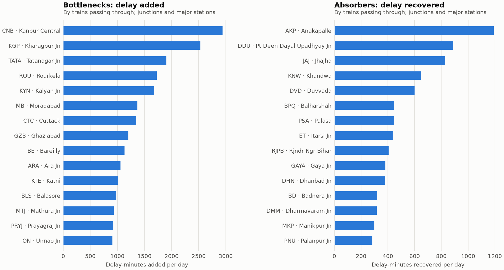

In plain terms (objective iv), there are two clusters:
- **The Howrah–Mumbai / Howrah–Chennai lines through SER and ECOR**: KGP, TATA, ROU, CTC, BLS. TATA is the
  most severe per train: +56.1 min for each train passing through, and 69.7% of on-time trains made late.
  Its worst approach is CKP→TATA.
- **The Delhi–Kanpur–Prayagraj trunk**: CNB (#1, by volume: 144.9 trains a day × +20.3 min), GZB, MB, BE, MTJ,
  PRYJ, ON. Kalyan (Mumbai suburban junction) is #5.

**Delay absorbers** are stations where through trains recover the most delay-minutes per day: AKP (−1,192),
DDU (−890), JAJ (−830), KNW (−650), DVD (−601) [results.md]. As the report's caveat says, a strong absorber
usually marks timetable padding rather than a well-run station. AKP shows it: 75.9% of late trains recover
there, yet 54.3% of on-time trains passing through are made late. ⚑ *The direction-specific scheduled minutes
around AKP that explain this (generous southbound, tight northbound) are in INTERVIEW_NOTES.md, Phase 7, not in
a report.*

**Does the model cope at bottlenecks?** [results.md]

| Stations | Test stops | Skill % [95% CI] | MAE persistence → hurdle |
|---|---:|---|---|
| Bottlenecks | 14,685 | 34.6 [33.5, 35.8] | 20.21 → 17.24 |
| Absorbers | 10,820 | **44.0** [43.0, 44.9] | 21.23 → 11.16 |
| Other junctions and major stations | 226,708 | 35.7 [35.4, 36.0] | 12.08 → 9.46 |
| Minor halts | 723,972 | 30.0 [29.6, 30.3] | 6.38 → 5.62 |

At bottlenecks the relative skill is about the same as at other big stations. The minute errors are larger
because the delays there are larger, so these stops are harder, not handled by a weaker model. Skill is highest at
absorbers: persistence fails worst where recovery is systematic, and the slack features capture that.

---

## 5 The application

`streamlit run app/streamlit_app.py` opens a dashboard with six tabs, kept to what a 10-minute demo needs.
The full tables are in `reports/` and in this report:

| Tab | Shows |
|---|---|
| Overview | Network delay level, headline model metrics, delay by month and by hour |
| Forecast a train | Pick a train, the last stop passed and its delay. Shows P(late > 15) and the forecast delay at every later stop, next to the train's historic median |
| Delay cascade | % still late h stops later, by initial delay (Section 2.3) |
| Model | The hurdle vs persistence and the single-stage model, and feature-group importance (Section 4.2) |
| Classes & bottlenecks | Skill by train class or corridor, and the top 10 bottleneck junctions (Sections 4.3, 4.4, 4.6) |
| DSF concepts | Every data-science concept the project uses, where it is used and why |

**How it serves the model** (details in [ARCHITECTURE.md §6](ARCHITECTURE.md#6-serving-how-the-app-finds-loads-and-checks-artifacts)):
- *One feature path.* The forecast builds a run from the timetable plus the delays entered and calls the same
  `features.build_features` used in training, so an app forecast is computed like a test-set prediction.
  ⚑ *A parity check found 0 mismatches between the app path and the training path on 509 real stops; it is
  recorded only in INTERVIEW_NOTES.md, Phase 8.*
- *Checked at load.* Saved input columns, horizon (must be 1 for the recursion), the late threshold, and
  library versions are compared with the code. A failed check disables the Forecast tab with the reason shown
  and keeps the other tabs working.
- *Fresh artifacts.* Cache keys include each file's modification time and size, so a retrained model is
  picked up without a restart.
- *Hosted demo.* `python -m trackcast.serving demo` packs the dev-sample model, profiles, results and a
  Parquet timetable into `demo/`. The app serves it when no local build exists (e.g. on Streamlit Community
  Cloud). The metrics on screen are the full model's, while the demo forecasts with the dev-sample model. ⚑ *Bundle size (18.7 MB) is from
  `demo/manifest.json`; cold start (~16 s), memory (~320 MB) and per-stop forecast time (~0.12 s) were
  measured once and are recorded in INTERVIEW_NOTES.md, Phase 8, not in a report.*

---

## 6 Limitations

- **Season, not weather.** No weather observations or station coordinates exist in the data. The fog effect
  (+7.6 min, difference in differences) is a season-and-region effect. It also carries winter timetables and
  holiday traffic on northern routes. The season flags add nothing to the model beyond the upstream delay
  [models.md].
- **Very late trains.** For trains already more than 3 h late, persistence beats the model in minutes (MAE
  17.81 vs 24.37). This shows up as a slightly worse MAE for Premium specials and Rajdhani [models.md,
  results.md].
- **The hurdle is not the best RMSLE model.** A single-stage HGB is better by 0.020 RMSLE (CI excludes 0). The
  hurdle is kept for P(late) and for MAE [models.md].
- **Multi-stop forecasts run low** far ahead (bias −14.55 min at 10 stops), and uncertainty is not propagated
  through the recursion [route_forecast.md].
- **Congestion from the timetable.** The timetable has no running days, so every train counts as daily, an
  upper bound. Trains passing without stopping are invisible. Congestion results are associations
  [eda.md, results.md].
- **Slack against the fastest train.** On a station pair shared with a Rajdhani, a passenger train's "slack" is
  partly a lower speed limit.
- **Observed, not causal.** Recovery, bottleneck and absorber rankings are measured against the timetable. A
  "bottleneck" may be a tight timetable and an "absorber" a padded one. A slow segment is shared between the
  departure change of one station and the arrival change of the next [results.md].
- **Descriptive tables include the test months.** Profiles, EDA and bottleneck tables cover the whole year.
  They never feed the model, but the cascade-profile baseline in Section 4.5 has seen the test months
  [route_forecast.md].
- **Laptop limits.** Training used about 1M of the 27.5M training-period rows (3.6%) [models.md], and each RF
  tree sees at most 100k bootstrap rows [config].
- **Heuristics.** Junctions are identified by "JN" in the station name. "Major station" is ≥ 100 scheduled
  trains a day [config]. The sawtooth flag is a rule of thumb.
- **Pickled models.** The model is a pickle, so it must be loaded with the library versions that saved it
  (pinned in `app/requirements.txt`) and only from trusted builds.

---

## 7 Future work

1. **Direct multi-horizon models.** `features.py --horizon H` already builds H-stop-ahead features. One model per
   horizon (or training on recursive rollouts) would remove the compounding bias instead of choosing what to
   feed forward, and would replace per-stop recursion with one batched call per route.
2. **A minutes-scale or quantile loss for the late part**, to fix the > 3 h regime, plus prediction intervals
   for the app.
3. **Real weather.** Geocode the 8,142 stations from their addresses and join Open-Meteo observations, as the
   proposal planned, to separate fog from other winter effects.
4. **Running days and through traffic** for congestion, if a timetable with running days and passing trains
   can be found.
5. **More training data.** Stream training (incremental HGB or out-of-core sampling) past the 1M-row cap.
6. **Per-train-type slack minima**, so slack is not confounded with line speed.
7. **Serving.** A FastAPI service that loads the model once per worker, `skops` instead of pickle, and
   `st.fragment` so a widget reruns only its own tab.

---

## 8 Conclusion

| Objective | Answer |
|---|---|
| (i) How do upstream delays propagate? | Strongly and persistently. 20 stops on, 89% of trains that started 1–3 h late and 99% of those > 3 h late are still late, and trains that started on time have gained 27 min on average [eda.md]. The cascade feature group dominates the model's importance (1.27 RMSLE vs 0.13 for the next group) [models.md]. |
| (ii) Minor vs severe delays | Stage 1 separates late (> 15 min) from on-time stops with F1 0.913 and ROC-AUC 0.962. The full hurdle cuts persistence's RMSLE by 33.2% [models.md, results.md]. |
| (iii) Weather, congestion, buffers and recovery | Slack is the clearest lever: with > 40 min of slack, 86% of late trains recover [features.md]. Fog season adds about 7.6 min in fog-prone zones, and the monsoon shows no slowdown [eda.md]. Busy stations go with recovery for slow trains and with loss for fast trains [eda.md]. Big stations recover more late trains but also make more on-time trains late [results.md]. |
| (iv) Bottlenecks in plain terms | Two clusters add the most delay: the SER / ECOR Howrah lines (KGP, TATA, ROU, CTC, BLS) and the Delhi–Kanpur–Prayagraj trunk (CNB, GZB, MB, BE, MTJ, PRYJ, ON). The places to look are the approach and exit segments listed in Section 4.6, e.g. CKP→TATA and NDLS→CNB [results.md]. |

---

## Appendix A: Claims not traceable to `reports/`

| Claim | Where it appears | Actual source |
|---|---|---|
| Stage 2 residual over persistence improved direct HGB dev RMSLE 0.703 → 0.684 | §2.4 | INTERVIEW_NOTES.md, Phase 3 (dev-sample run; the report was overwritten by the full run) |
| RF median P(late) 0.973 for trains > 3 h late; calibration cut their dev MAE 47.7 → 29.2 min | §2.4 | INTERVIEW_NOTES.md, Phase 3 (dev sample) |
| Dev-sample model RMSLE 0.701 (75k rows) vs 0.6355 (1M rows) | §4.2 | INTERVIEW_NOTES.md, Phase 3. Row count 75,045 in `demo/manifest.json` |
| AKP scheduled minutes by direction | §4.6 | INTERVIEW_NOTES.md, Phase 7 |
| App/training feature parity: 0 mismatches on 509 stops | §5 | INTERVIEW_NOTES.md, Phase 8 |
| Demo bundle 18.7 MB; cold start ~16 s, ~320 MB RSS, ~0.12 s per forecast stop | §5 | `demo/manifest.json` (size); INTERVIEW_NOTES.md, Phase 8 and README (timings) |

Two counts look inconsistent but are not. **67 vs 112 sawtooth stations**: 67 among the 5,385 stations with
≥ 2,000 arrivals [profiles.md], 112 over all stations [results.json `meta.suspect_stations`]. **RMSLE 0.6355 vs
0.635**: [models.md] prints 4 decimals, [results.md] rounds the same value to 3.

## Appendix B: Reproducing the results

Setup, the pipeline commands in order, and what each builds are in the [README](../README.md#quickstart) and
[ARCHITECTURE.md §3](ARCHITECTURE.md#3-artifacts-and-the-command-that-builds-each). Each `--full` step prints its
own elapsed time in its report (e.g. training 2,533 s [models.md]).
