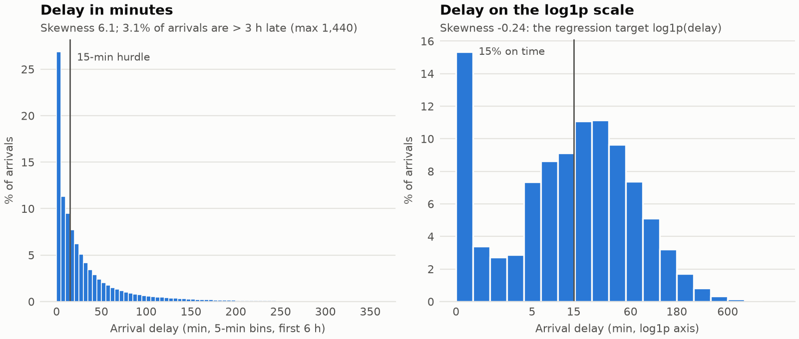
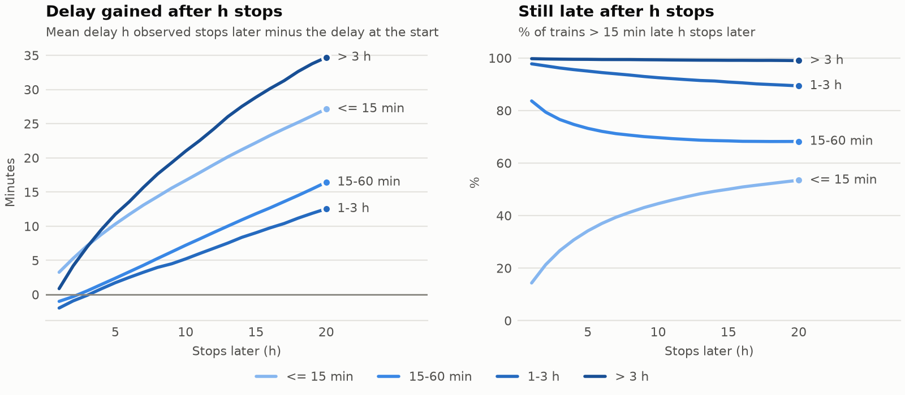
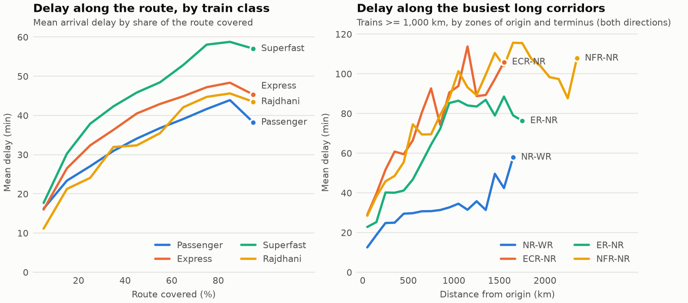
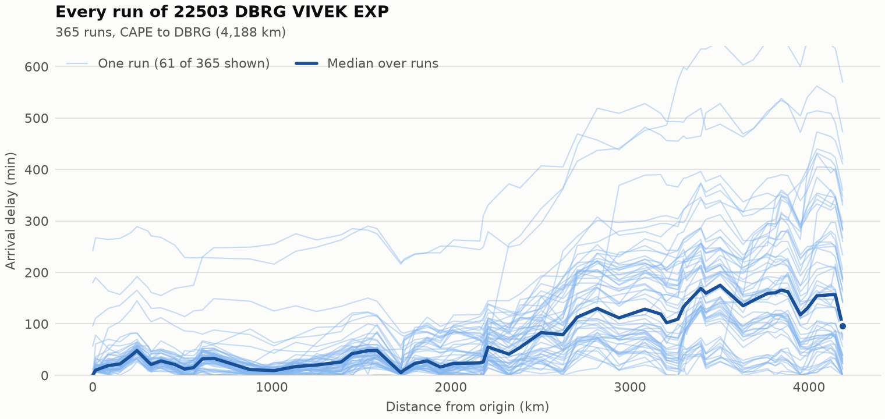
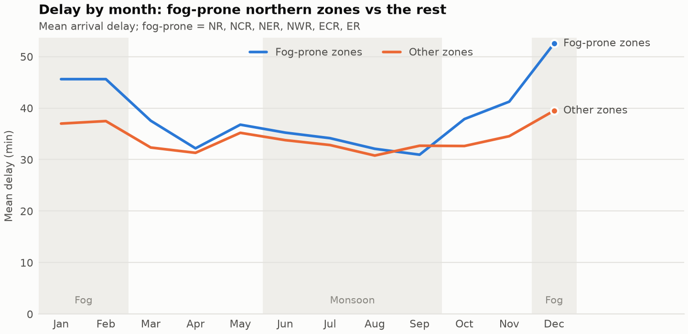
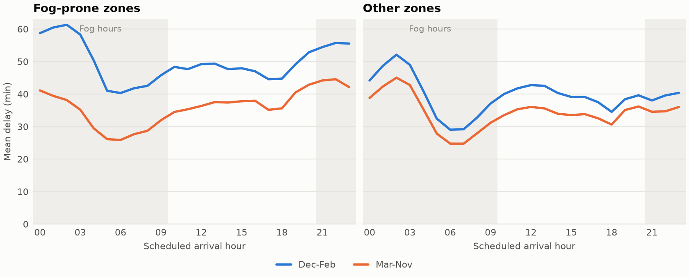
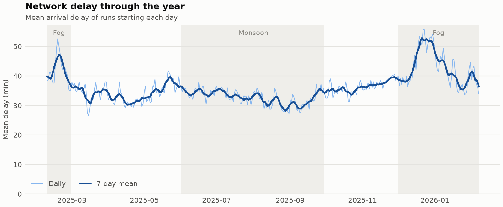
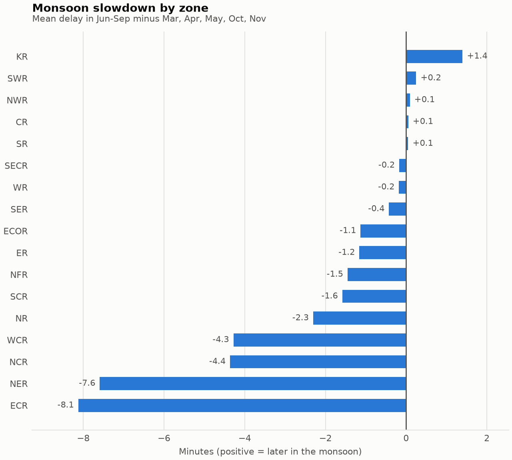
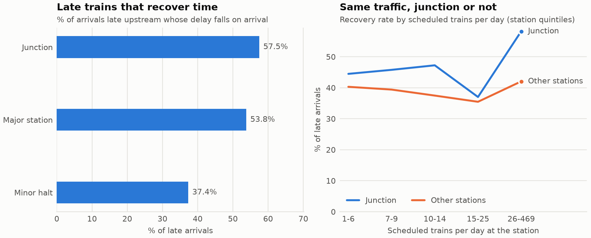
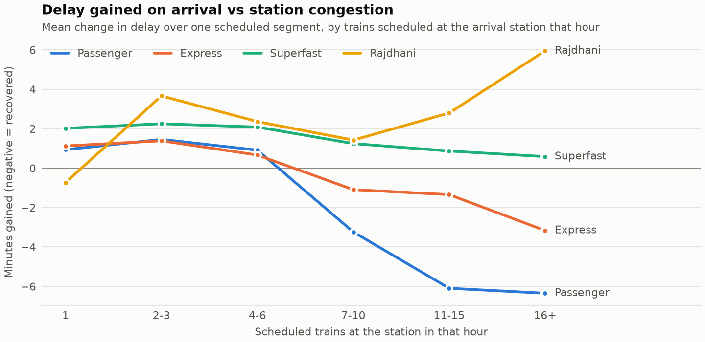

# Exploratory analysis (Phase 6)

Source `clean.parquet` (36,500,515 scheduled stops) and the Phase 4 profiles in `data\processed\profiles/`. Sum tables in `data\processed\eda/`; figures in `reports/figures/`; `notebooks/01_eda.ipynb` shows them with the tables. All delays in minutes; *change* = delay at a stop minus delay at the previous observed stop (negative = time recovered); *late* = more than 15 min.

## 1. Delay distribution: why log1p and why a hurdle

- 36,025,806 observed arrivals. Mean 36.1, median 16, p90 88, p99 309, max 1,440.
- 15.3% exactly on time (0 after clipping early arrivals), 50.6% late, 3.1% more than 3 h late.
- Skewness 6.14 in minutes vs -0.24 after log1p: squared error on raw minutes would be dominated by the few multi-hour delays, so Stage 2 regresses log1p(delay) and is scored with RMSLE. The spike at 0 is a separate population, which is what Stage 1 models.

## 2. Cascading delay trajectories

From Phase 4's cascade table, by the delay at the starting stop, 20 observed stops later:

| Initial delay | Pairs | Mean delay gained | % still late |
|---|---:|---:|---:|
| <= 15 | 4,175,547 | 27.16 | 53.43 |
| (15, 60] | 2,911,236 | 16.44 | 68.21 |
| (60, 180] | 1,076,438 | 12.54 | 89.38 |
| > 180 | 235,498 | 34.7 | 98.99 |

**By train class** (all classes; the chart shows the four the proposal names). *Recovery* = % of arrivals late at the previous stop whose delay falls on arrival. *Congestion sensitivity* = least-squares slope of the delay change over one scheduled segment on the trains scheduled at the arrival station in that hour, in minutes per 10 extra trains.

| Class | Trains | Runs | Arrivals | Mean delay | % late | Mean change | % late that recover | Change if late | Congestion: min per +10 trains/h |
|---|---:|---:|---:|---:|---:|---:|---:|---:|---:|
| Passenger | 3,056 | 1,028,942 | 17,570,581 | 32.75 | 48.53 | 0.89 | 39.5 | -0.78 | -4.55 |
| Express | 2,056 | 471,263 | 12,867,733 | 37.48 | 53.48 | 0.72 | 44.69 | -1.82 | -2.68 |
| Superfast | 1,354 | 247,001 | 4,803,960 | 44.04 | 52.73 | 1.72 | 46.86 | -0.73 | -1.06 |
| Vande Bharat (T18) | 194 | 42,631 | 328,173 | 15.29 | 26.55 | 1.09 | 58.49 | -3.56 | -0.3 |
| Shatabdi | 42 | 13,162 | 97,828 | 15.04 | 23.58 | 1.52 | 58.75 | -2.55 | -0.43 |
| Premium / special | 106 | 11,449 | 150,469 | 96.12 | 54.94 | 8.25 | 44.03 | 8.22 | 3.81 |
| Rajdhani | 48 | 9,722 | 112,788 | 32.36 | 36.41 | 3.04 | 58.97 | 0.26 | 1.92 |
| Garib Rath | 52 | 6,114 | 94,274 | 52.52 | 51.77 | 2.63 | 45.77 | 0.1 | -1.93 |

**By corridor** (zones of origin and terminus, both directions; the 15 with the most runs, >= 300 runs). Charted: NR-WR, ECR-NR, ER-NR, NFR-NR (trains >= 1,000 km).

| Corridor | Trains | Runs | Arrivals | Mean delay | % late | Mean change | % late that recover | Change if late | Congestion: min per +10 trains/h |
|---|---:|---:|---:|---:|---:|---:|---:|---:|---:|
| within NR | 566 | 182,956 | 2,749,713 | 31.93 | 51.87 | 1.35 | 34.42 | 0.27 | -1.81 |
| within SR | 484 | 156,565 | 2,802,771 | 12.96 | 30.46 | 0.13 | 48.14 | -3.59 | -2.7 |
| within WR | 373 | 117,875 | 1,832,649 | 11.21 | 25.12 | 0.1 | 54.12 | -3.12 | -0.87 |
| within ECR | 310 | 100,108 | 2,081,389 | 49.17 | 65.23 | 0.89 | 41.5 | -1.08 | -8.05 |
| within ER | 277 | 93,622 | 1,470,742 | 18.59 | 35.59 | 0.56 | 35.23 | -0.72 | -2.82 |
| within SCR | 282 | 87,019 | 1,655,831 | 37.47 | 60.43 | 0.4 | 42.41 | -3.98 | -4.22 |
| within SWR | 205 | 67,024 | 1,070,375 | 15.2 | 34.26 | 0.21 | 48.7 | -3.26 | -2.69 |
| within NFR | 196 | 60,281 | 1,101,540 | 30.41 | 52.52 | 0.61 | 41.85 | -1.57 | -6.98 |
| within NER | 183 | 58,905 | 1,084,759 | 44.09 | 51.08 | 1.17 | 41.55 | -0.06 | -2.39 |
| within CR | 184 | 52,814 | 701,470 | 25.64 | 48.82 | 0.98 | 43.0 | -1.28 | -3.42 |
| NR-NWR | 156 | 46,225 | 1,061,008 | 24.7 | 44.47 | 0.57 | 41.47 | -1.57 | -4.0 |
| within NWR | 130 | 45,002 | 869,572 | 14.81 | 32.37 | -0.02 | 43.61 | -2.65 | -9.2 |
| within SECR | 132 | 44,789 | 739,678 | 45.96 | 60.13 | 2.01 | 34.6 | 1.08 | -2.05 |
| within SER | 140 | 39,663 | 568,754 | 40.09 | 40.6 | 2.54 | 53.14 | 0.55 | -1.62 |
| ECR-ER | 110 | 32,345 | 765,384 | 34.9 | 57.45 | 0.59 | 38.43 | -1.27 | -2.98 |

Train 22503 DBRG VIVEK EXP (365 runs), across runs: at CAPE median 0 min (p10-p90 0-6.6); at DBRG median 95.5 min (p10-p90 0-348.7). The same train on the same route ends hours apart, so a train's or a station's average delay says little about one run; the run's own upstream delay does.

## 3. Seasonal slowdowns: fog and monsoon

| | Fog-prone zones | Other zones | Difference |
|---|---:|---:|---:|
| Mean delay, Dec-Feb minus Mar-Nov | +12.7 | +5.1 | **+7.6** |
| Mean change on arrival, Dec-Feb minus Mar-Nov | +0.77 | +0.14 | **+0.63** |

Within fog-prone zones, the Dec-Feb uplift in mean delay is +15.1 min for arrivals scheduled in fog hours (21:00-10:00) vs +10.5 min in daytime (+4.5). This is what the `fog_season` and `fog_night` features encode.

**Season level** (all zones)

| Season | Arrivals | Mean delay | % late | Mean change |
|---|---:|---:|---:|---:|
| dry | 15,151,506 | 35.01 | 49.82 | 0.91 |
| fog | 8,683,456 | 42.48 | 54.85 | 1.29 |
| monsoon | 12,190,844 | 32.78 | 48.51 | 0.84 |

Zones with >= 20,000 arrivals in each season. *Diff* columns are monsoon minus dry months (Mar-May, Oct-Nov).

| Zone | Monsoon arrivals | Dry arrivals | Mean delay, dry | Mean delay, monsoon | Delay diff | Change diff |
|---|---:|---:|---:|---:|---:|---:|
| KR | 78,320 | 98,676 | 43.45 | 44.85 | 1.4 | -0.05 |
| SWR | 561,999 | 699,868 | 18.89 | 19.14 | 0.25 | -0.01 |
| NWR | 716,743 | 886,516 | 17.87 | 17.96 | 0.09 | 0.01 |
| CR | 546,769 | 682,359 | 36.76 | 36.82 | 0.05 | 0.18 |
| SR | 1,162,941 | 1,451,925 | 15.87 | 15.92 | 0.05 | -0.01 |
| SECR | 442,307 | 544,165 | 55.01 | 54.83 | -0.17 | 0.16 |
| WR | 894,101 | 1,108,829 | 14.3 | 14.12 | -0.18 | -0.01 |
| SER | 517,654 | 638,659 | 52.32 | 51.9 | -0.43 | 0.08 |
| ECOR | 474,994 | 588,880 | 51.1 | 49.97 | -1.13 | 0.08 |
| ER | 768,257 | 968,231 | 24.06 | 22.9 | -1.16 | 0.05 |
| NFR | 494,198 | 622,744 | 34.17 | 32.72 | -1.45 | 0.07 |
| SCR | 1,015,866 | 1,256,122 | 42.05 | 40.47 | -1.58 | -0.0 |
| NR | 1,612,720 | 1,971,445 | 33.44 | 31.14 | -2.3 | -0.13 |
| WCR | 469,316 | 587,786 | 44.33 | 40.05 | -4.28 | -0.24 |
| NCR | 519,476 | 639,898 | 41.09 | 36.72 | -4.36 | -0.43 |
| NER | 646,974 | 802,092 | 47.69 | 40.1 | -7.59 | -0.35 |
| ECR | 1,268,209 | 1,603,311 | 53.44 | 45.32 | -8.12 | -0.31 |

Caveat: there are no weather observations in the data, so these are *season* effects. Fog-month delay also carries winter timetable changes and holiday traffic; the comparison with other zones in the same months (difference in differences) removes the network-wide part of that.

## 4. Schedule recovery: junctions vs minor halts

Junction = station name contains `JN`; major station = any other station with >= 100 distinct scheduled trains a day; the rest are minor halts. Stations Phase 4 flags as timetable errors (sawtooth) are left out.

| Class | Stations | Arrivals | Mean delay | % late | Late arrivals | % that recover | Change if late | Median trains/day | Median sched. dwell |
|---|---:|---:|---:|---:|---:|---:|---:|---:|---:|
| Junction | 362 | 6,035,979 | 37.52 | 45.91 | 2,823,887 | 57.53 | -4.49 | 67.0 | 2.0 |
| Major station | 146 | 3,812,591 | 40.94 | 49.66 | 1,906,313 | 53.84 | -3.47 | 136.0 | 2.0 |
| Minor halt | 7,483 | 25,803,402 | 34.89 | 51.67 | 12,700,502 | 37.36 | 0.25 | 10.0 | 1.0 |

**Recovery by traffic** (station quintiles of scheduled trains per day)

| Trains/day | Stations | Count | % that recover |
|---|---|---:|---:|
| 1-6 | Junction | 5 | 44.48 |
| 1-6 | Other stations | 1,435 | 40.3 |
| 7-9 | Junction | 14 | 45.78 |
| 7-9 | Other stations | 1,702 | 39.41 |
| 10-14 | Junction | 17 | 47.24 |
| 10-14 | Other stations | 1,480 | 37.47 |
| 15-25 | Junction | 41 | 37.02 |
| 15-25 | Other stations | 1,651 | 35.47 |
| 26-469 | Junction | 284 | 58.21 |
| 26-469 | Other stations | 1,318 | 42.05 |

Recovery is measured on arrival, so it covers the inbound segment and the dwell at the previous stop, not the dwell at the station itself.

## 5. Congestion

| Class | Trains/h at station | Segments | Mean change |
|---|---|---:|---:|
| Express | 1 | 3,445,928 | 1.12 |
| Express | 2-3 | 4,354,663 | 1.39 |
| Express | 4-6 | 2,344,417 | 0.66 |
| Express | 7-10 | 1,229,514 | -1.09 |
| Express | 11-15 | 584,397 | -1.35 |
| Express | 16+ | 260,399 | -3.17 |
| Passenger | 1 | 7,548,561 | 0.94 |
| Passenger | 2-3 | 6,581,792 | 1.46 |
| Passenger | 4-6 | 1,572,125 | 0.91 |
| Passenger | 7-10 | 505,725 | -3.24 |
| Passenger | 11-15 | 209,238 | -6.1 |
| Passenger | 16+ | 89,006 | -6.35 |
| Rajdhani | 1 | 4,489 | -0.73 |
| Rajdhani | 2-3 | 11,062 | 3.66 |
| Rajdhani | 4-6 | 21,538 | 2.36 |
| Rajdhani | 7-10 | 28,776 | 1.42 |
| Rajdhani | 11-15 | 14,996 | 2.8 |
| Rajdhani | 16+ | 20,304 | 5.95 |
| Superfast | 1 | 480,287 | 2.02 |
| Superfast | 2-3 | 1,130,850 | 2.25 |
| Superfast | 4-6 | 1,106,027 | 2.08 |
| Superfast | 7-10 | 895,626 | 1.25 |
| Superfast | 11-15 | 552,346 | 0.87 |
| Superfast | 16+ | 331,412 | 0.58 |

Congestion counts trains *scheduled* at the station in the same clock hour (the timetable has no running days, so every train counts as daily). Busy stations are also the big stations with recovery allowances, so this is an association, not the effect of one extra train.

Elapsed: 198.6 s.