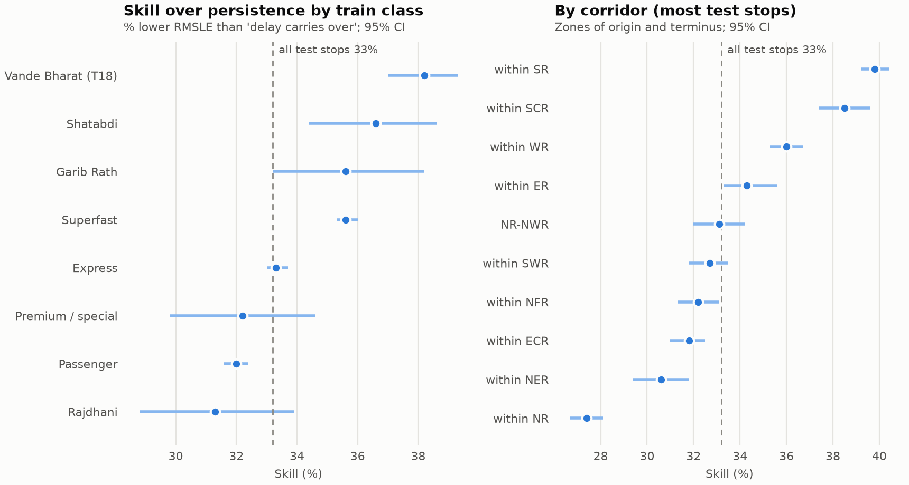
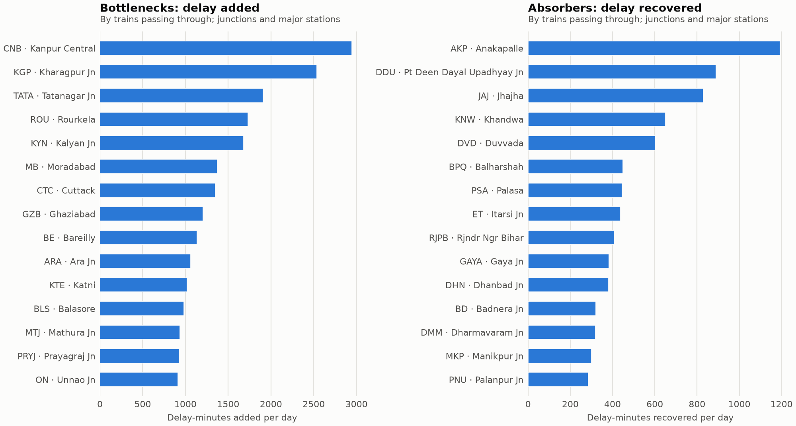

# Results per train class and route; bottleneck junctions (Phase 7)

Model scores on the Phase 3 test set (`test_predictions.parquet`, 996,417 stops); through-station delay from `clean.parquet` (36,500,515 scheduled stops, 365 days). Tables in `data/processed/results/`. All delays in minutes; *late* = more than 15 min.

- **Skill** = 100 x (1 - RMSLE hurdle / RMSLE persistence): how much of persistence's error the model removes. The interval is a 95% day-block bootstrap (1,000 resamples of whole test days, shared by all groups). Persistence = "the delay at the previous stop carries over".
- Groups need >= 2,000 test stops; trains >= 300.
- All test stops: RMSLE 0.952 (persistence) vs 0.635 (hurdle), skill **33.2%** [33.0, 33.4]; F1 0.887 vs 0.913; MAE 8.30 vs 6.83 min.

## 1. Results per train class

Model columns are test-set scores (Dec to Feb); the last columns describe the class over the whole year (Phase 6): mean delay, % of late arrivals that recover on arrival, congestion sensitivity (minutes per +10 scheduled trains/h) and mean delay gained from origin to terminus (Phase 4).

| Class | Test stops | % late | RMSLE persistence | RMSLE hurdle | Skill % [95% CI] | MAE persistence | MAE hurdle | F1 persistence | F1 hurdle | Year mean delay | Year % recover | Congestion slope | Gained en route |
|---|---:|---:|---:|---:|---|---:|---:|---:|---:|---:|---:|---:|---:|
| Passenger | 474,245 | 55.4 | 0.88 | 0.599 | 32.0 [31.6, 32.4] | 6.76 | 5.64 | 0.913 | 0.932 | 32.8 | 39.5 | -4.5 | 14.3 |
| Express | 364,250 | 60.3 | 0.988 | 0.658 | 33.3 [33.0, 33.7] | 8.93 | 7.16 | 0.875 | 0.904 | 37.5 | 44.7 | -2.7 | 18.8 |
| Superfast | 135,894 | 61.5 | 1.042 | 0.671 | 35.6 [35.3, 36.0] | 11.26 | 9.26 | 0.849 | 0.888 | 44.0 | 46.9 | -1.1 | 32.3 |
| Vande Bharat (T18) | 9,611 | 38.1 | 1.233 | 0.762 | 38.2 [37.0, 39.3] | 8.68 | 7.0 | 0.72 | 0.792 | 15.3 | 58.5 | -0.3 | 7.5 |
| Premium / special | 4,407 | 66.6 | 1.125 | 0.763 | 32.2 [29.8, 34.6] | 21.17 | 21.52 | 0.867 | 0.896 | 96.1 | 44.0 | 3.8 | 99.9 |
| Rajdhani | 3,138 | 55.4 | 1.235 | 0.848 | 31.3 [28.8, 33.9] | 16.7 | 17.55 | 0.794 | 0.835 | 32.4 | 59.0 | 1.9 | 32.2 |
| Shatabdi | 2,453 | 45.8 | 1.237 | 0.784 | 36.6 [34.4, 38.6] | 9.63 | 9.35 | 0.768 | 0.81 | 15.0 | 58.8 | -0.4 | 9.8 |
| Garib Rath | 2,419 | 59.8 | 1.162 | 0.748 | 35.6 [33.2, 38.2] | 14.35 | 11.71 | 0.818 | 0.865 | 52.5 | 45.8 | -1.9 | 39.9 |

## 2. Results per route

**By corridor** (zones of origin and terminus, both directions; the 15 with the most test stops). Year columns from Phase 6.

| Corridor | Test stops | % late | RMSLE persistence | RMSLE hurdle | Skill % [95% CI] | MAE persistence | MAE hurdle | F1 persistence | F1 hurdle | Trains | Year mean delay | Year % recover | Congestion slope |
|---|---:|---:|---:|---:|---|---:|---:|---:|---:|---:|---:|---:|---:|
| within SR | 78,696 | 35.2 | 1.036 | 0.624 | 39.8 [39.2, 40.4] | 5.37 | 3.77 | 0.792 | 0.849 | 484 | 13.0 | 48.1 | -2.7 |
| within NR | 68,858 | 62.6 | 0.784 | 0.57 | 27.4 [26.7, 28.1] | 6.27 | 5.87 | 0.924 | 0.933 | 566 | 31.9 | 34.4 | -1.8 |
| within ECR | 60,450 | 70.7 | 0.945 | 0.644 | 31.8 [31.0, 32.5] | 9.42 | 7.41 | 0.926 | 0.943 | 310 | 49.2 | 41.5 | -8.0 |
| within WR | 50,441 | 30.7 | 0.938 | 0.6 | 36.0 [35.3, 36.7] | 4.59 | 3.6 | 0.79 | 0.831 | 373 | 11.2 | 54.1 | -0.9 |
| within SCR | 46,510 | 64.1 | 1.249 | 0.768 | 38.5 [37.4, 39.6] | 12.06 | 8.26 | 0.85 | 0.899 | 282 | 37.5 | 42.4 | -4.2 |
| within ER | 40,237 | 43.4 | 0.768 | 0.504 | 34.3 [33.3, 35.6] | 4.29 | 3.7 | 0.903 | 0.925 | 277 | 18.6 | 35.2 | -2.8 |
| within NFR | 31,065 | 65.1 | 0.903 | 0.612 | 32.2 [31.3, 33.1] | 8.16 | 6.46 | 0.909 | 0.931 | 196 | 30.4 | 41.9 | -7.0 |
| within SWR | 31,029 | 38.1 | 1.062 | 0.715 | 32.7 [31.8, 33.5] | 6.02 | 4.87 | 0.805 | 0.85 | 205 | 15.2 | 48.7 | -2.7 |
| within NER | 29,590 | 59.1 | 0.832 | 0.578 | 30.6 [29.4, 31.8] | 6.28 | 5.47 | 0.926 | 0.938 | 183 | 44.1 | 41.5 | -2.4 |
| NR-NWR | 28,168 | 58.7 | 0.849 | 0.568 | 33.1 [32.0, 34.2] | 6.37 | 5.9 | 0.898 | 0.919 | 156 | 24.7 | 41.5 | -4.0 |
| within NWR | 24,906 | 41.8 | 0.836 | 0.583 | 30.3 [29.0, 31.6] | 4.47 | 3.91 | 0.871 | 0.9 | 130 | 14.8 | 43.6 | -9.2 |
| ECR-ER | 22,196 | 65.8 | 0.846 | 0.564 | 33.3 [31.8, 34.7] | 7.5 | 6.29 | 0.917 | 0.936 | 110 | 34.9 | 38.4 | -3.0 |
| within SECR | 20,223 | 70.2 | 0.77 | 0.574 | 25.4 [23.9, 27.0] | 7.89 | 7.06 | 0.948 | 0.954 | 132 | 46.0 | 34.6 | -2.1 |
| within CR | 19,689 | 55.6 | 0.95 | 0.625 | 34.2 [33.2, 35.3] | 7.66 | 5.65 | 0.871 | 0.906 | 184 | 25.6 | 43.0 | -3.4 |
| within ECOR | 19,195 | 67.5 | 0.808 | 0.61 | 24.6 [23.0, 26.0] | 6.42 | 5.37 | 0.935 | 0.946 | 94 | 40.3 | 35.8 | -0.3 |

**By train** (859 trains with >= 300 test stops). Skill per train: median 31.4%, middle half 24.8% to 38.2%, 10th to 90th percentile 18.0% to 44.6%. The hurdle has a higher RMSLE than persistence on 16 trains, and on 8 the whole 95% interval is below zero. Ranked by *RMSLE gain* = RMSLE persistence - RMSLE hurdle (a relative skill explodes for trains whose persistence error is already near zero). Largest gains:

| Train | Name | Type | Corridor | Test stops | % late | RMSLE persistence | RMSLE hurdle | RMSLE gain | Skill % | MAE persistence | MAE hurdle |
|---|---|---|---|---:|---:|---:|---:|---:|---:|---:|---:|
| 67259 | BZA BTTR MEMU | PASS-TRAINS | within SCR | 320 | 70.0 | 2.272 | 1.117 | 1.155 | 50.8 | 34.38 | 14.6 |
| 67258 | BZA NS DEMU | PASS-TRAINS | within SCR | 308 | 39.0 | 1.888 | 0.832 | 1.056 | 55.9 | 11.2 | 5.11 |
| 18125 | ROU PURI EXP | EXP-TRAINS | ECOR-SER | 390 | 78.5 | 2.032 | 1.117 | 0.916 | 45.1 | 41.59 | 22.76 |
| 63206 | PNBE KIUL MEMU | PASS-TRAINS | within ECR | 324 | 77.8 | 2.262 | 1.361 | 0.901 | 39.8 | 41.33 | 24.52 |
| 66305 | CAPE QLN EMU | PASS-TRAINS | within SR | 450 | 55.3 | 1.851 | 0.992 | 0.858 | 46.4 | 23.1 | 10.79 |
| 63271 | MKA PNBE MEMU | PASS-TRAINS | within ECR | 338 | 63.9 | 2.168 | 1.353 | 0.815 | 37.6 | 22.12 | 13.72 |
| 56600 | CAN SRR PASSENGER | PASS-TRAINS | within SR | 384 | 71.6 | 1.588 | 0.773 | 0.815 | 51.3 | 12.01 | 6.06 |
| 17253 | GNT AWB EXPRESS | EXP-TRAINS | within SCR | 975 | 60.8 | 1.691 | 0.893 | 0.798 | 47.2 | 18.4 | 9.85 |
| 16529 | SMVB KIK EXPRESS | EXP-TRAINS | SR-SWR | 495 | 49.9 | 1.583 | 0.833 | 0.75 | 47.4 | 11.71 | 6.46 |
| 56812 | ED JTJ PASSENGER | PASS-TRAINS | within SR | 308 | 83.1 | 1.433 | 0.693 | 0.74 | 51.6 | 13.21 | 6.82 |

Largest losses:

| Train | Name | Type | Corridor | Test stops | % late | RMSLE persistence | RMSLE hurdle | RMSLE gain | Skill % | MAE persistence | MAE hurdle |
|---|---|---|---|---:|---:|---:|---:|---:|---:|---:|---:|
| 53351 | BRWD CAR PASSENGER | PASS-TRAINS | ECR-NCR | 341 | 71.0 | 0.667 | 0.844 | -0.177 | -26.5 | 6.06 | 4.45 |
| 53352 | CAR BRWD PASS | PASS-TRAINS | ECR-NCR | 465 | 50.8 | 0.58 | 0.726 | -0.146 | -25.1 | 5.14 | 5.68 |
| 58501 | VSKP KRDL PASSENGER | PASS-TRAINS | within ECOR | 528 | 71.6 | 0.746 | 0.841 | -0.095 | -12.8 | 4.61 | 4.7 |
| 14897 | BKN HSR EXP | EXP-TRAINS | within NWR | 336 | 47.0 | 0.833 | 0.926 | -0.093 | -11.2 | 4.67 | 5.01 |
| 68104 | BQA MSAE MEMU | PASS-TRAINS | ER-SER | 310 | 0.0 | 0.22 | 0.297 | -0.077 | -35.0 | 0.13 | 0.27 |
| 52466 | BJPL NUPR PASSENGER | PASS-TRAINS | within NR | 494 | 69.4 | 0.629 | 0.684 | -0.055 | -8.8 | 2.96 | 6.78 |
| 58502 | KRDL VSKP PASSENGER | PASS-TRAINS | within ECOR | 384 | 59.6 | 0.423 | 0.477 | -0.054 | -12.7 | 5.25 | 4.58 |
| 54789 | RE BKN PASSENGER | PASS-TRAINS | within NWR | 528 | 43.6 | 0.822 | 0.875 | -0.053 | -6.5 | 4.76 | 5.2 |
| 68111 | MFCK BQA MEMU | PASS-TRAINS | within SER | 330 | 9.4 | 0.486 | 0.536 | -0.051 | -10.4 | 1.42 | 2.93 |
| 64452 | KKDE DLI EMU | PASS-TRAINS | within NR | 351 | 80.1 | 0.285 | 0.325 | -0.041 | -14.3 | 3.67 | 3.27 |

## 3. Schedule recovery through stations

For every train passing straight through a station (previous and next scheduled stops both observed in the run): *arrival* = change from the stop before to the station, *departure* = change from the station to the stop after (platform dwell + exit), *through* = both. *% late that recover* = trains late (> 15 min) at the stop before that are less late at the stop after; *% on time made late* = trains on time at the stop before that are late at the stop after. Triples touching one of the 112 suspected timetable errors (Phase 4) are left out.

| Class | Stations | Trains through | Arrival | Departure | Through | % late that recover | % on time made late |
|---|---:|---:|---:|---:|---:|---:|---:|
| Junction | 358 | 4,433,267 | 1.2 | 1.8 | 3.0 | 52.8 | 28.7 |
| Major station | 141 | 2,808,244 | 1.8 | 2.0 | 3.8 | 51.6 | 32.7 |
| Minor halt | 7,304 | 23,955,832 | 1.8 | 0.4 | 2.2 | 42.5 | 18.3 |

## 4. Bottleneck junctions

Candidates: junctions and major stations (Phase 6 classes) with >= 2,000 trains through (472 stations, 334 of them add delay on balance). Ranked by *Min/day* = delay-minutes added per day by all trains passing through (mean through change x trains through per day). The top 15 add 26% of the minutes added by all delay-adding candidates. *Worst approach / exit* = the inbound / outbound segment adding the most delay-minutes over the year (mean change per train in brackets).

| Code | Station | Zone | Trains/day | Through/day | Arrival | Departure | Through | % late that recover | % on time made late | Min/day | Worst approach | Worst exit |
|---|---|---|---:|---:|---:|---:|---:|---:|---:|---:|---|---|
| CNB | KANPUR CENTRAL | NCR | 436 | 144.9 | 8.5 | 11.9 | 20.3 | 46.4 | 44.8 | 2945.4 | NDLS→CNB (+31.7) | CNB→NDLS (+23.6) |
| KGP | KHARAGPUR JN | SER | 274 | 83.7 | 14.3 | 16.1 | 30.3 | 24.4 | 47.3 | 2538.4 | BLS→KGP (+23.9) | KGP→SRC (+40.6) |
| TATA | TATANAGAR JN | SER | 185 | 34.0 | 33.6 | 22.5 | 56.1 | 11.1 | 69.7 | 1906.7 | CKP→TATA (+73.9) | TATA→CKP (+43.0) |
| ROU | ROURKELA | SER | 144 | 42.6 | 25.2 | 15.5 | 40.7 | 14.3 | 51.1 | 1732.7 | JSG→ROU (+39.7) | ROU→CKP (+30.9) |
| KYN | KALYAN JN | CR | 323 | 130.1 | 10.3 | 2.6 | 12.9 | 41.8 | 56.3 | 1679.6 | TNA→KYN (+7.6) | KYN→PUNE (+16.1) |
| MB | MORADABAD | NR | 280 | 94.0 | 1.5 | 13.1 | 14.6 | 46.7 | 50.2 | 1372.5 | BE→MB (+9.1) | MB→BE (+16.7) |
| CTC | CUTTACK | ECOR | 230 | 76.7 | 10.9 | 6.7 | 17.6 | 21.4 | 71.1 | 1349.2 | JJKR→CTC (+17.5) | CTC→JJKR (+17.0) |
| GZB | GHAZIABAD | NR | 291 | 131.5 | 0.2 | 9.0 | 9.2 | 49.0 | 41.8 | 1205.7 | MB→GZB (+21.3) | GZB→SBB (+5.3) |
| BE | BAREILLY | NR | 204 | 66.2 | 10.5 | 6.6 | 17.1 | 29.2 | 43.2 | 1133.6 | MB→BE (+16.7) | BE→RMU (+11.6) |
| ARA | ARA JN | ECR | 192 | 56.2 | 9.0 | 9.9 | 18.9 | 17.1 | 64.0 | 1062.6 | DNR→ARA (+13.1) | ARA→BXR (+13.6) |
| KTE | KATNI | WCR | 201 | 55.5 | 11.8 | 6.6 | 18.4 | 24.5 | 75.8 | 1021.2 | JBP→KTE (+18.2) | KTE→MYR (+11.9) |
| BLS | BALASORE | SER | 185 | 56.8 | 9.5 | 7.8 | 17.3 | 31.6 | 47.7 | 982.3 | BHC→BLS (+14.7) | BLS→KGP (+23.9) |
| MTJ | MATHURA JN | NCR | 254 | 103.9 | 8.0 | 1.0 | 9.0 | 50.1 | 43.0 | 936.6 | AGC→MTJ (+12.7) | MTJ→AGC (+5.9) |
| PRYJ | PRAYAGRAJ JN | NCR | 262 | 81.3 | 6.2 | 5.2 | 11.4 | 52.0 | 38.3 | 927.6 | DDU→PRYJ (+15.3) | PRYJ→CNB (+13.7) |
| ON | UNNAO JN | NR | 121 | 56.7 | 8.2 | 7.9 | 16.1 | 26.2 | 39.3 | 911.8 | CNB→ON (+6.0) | ON→CNB (+8.8) |

**Delay absorbers**: junctions and major stations where trains passing through recover the most delay-minutes per day (negative = recovered).

| Code | Station | Zone | Trains/day | Through/day | Arrival | Departure | Through | % late that recover | % on time made late | Min/day | Worst approach | Worst exit |
|---|---|---|---:|---:|---:|---:|---:|---:|---:|---:|---|---|
| AKP | ANAKAPALLE | SCR | 100 | 42.0 | -15.2 | -13.2 | -28.4 | 75.9 | 54.3 | -1192.3 | DVD→AKP (+4.8) | AKP→YLM (+11.9) |
| DDU | PT DEEN DAYAL UPADHYAY JN | ECR | 359 | 117.5 | -15.9 | 8.4 | -7.6 | 75.5 | 20.3 | -889.9 | CNB→DDU (+5.6) | DDU→PRYJ (+15.3) |
| JAJ | JHAJHA | ECR | 144 | 52.8 | -25.1 | 9.4 | -15.7 | 85.8 | 35.1 | -829.6 | BJU→JAJ (+12.5) | JAJ→JSME (+14.6) |
| KNW | KHANDWA | CR | 173 | 62.1 | -16.6 | 6.2 | -10.5 | 83.0 | 22.3 | -649.9 | BRGJ→KNW (-9.6) | KNW→ET (+5.7) |
| DVD | DUVVADA | ECOR | 137 | 51.8 | -19.1 | 7.5 | -11.6 | 75.7 | 22.3 | -601.0 | VSKP→DVD (+1.9) | DVD→VSKP (+5.8) |
| BPQ | BALHARSHAH | CR | 193 | 44.8 | -23.3 | 13.3 | -10.0 | 79.2 | 42.4 | -448.9 | KZJ→BPQ (-8.1) | BPQ→SKZR (+12.3) |
| PSA | PALASA | ECOR | 144 | 49.2 | -15.0 | 6.0 | -9.1 | 77.8 | 21.8 | -445.8 | PUN→PSA (-8.3) | PSA→CHE (+6.8) |
| ET | ITARSI JN | WCR | 398 | 131.7 | -11.2 | 7.8 | -3.3 | 70.8 | 38.7 | -436.7 | KNW→ET (+5.7) | ET→JBP (+21.1) |
| RJPB | RJNDR NGR BIHAR | ECR | 103 | 58.6 | 3.2 | -10.2 | -6.9 | 61.0 | 26.5 | -406.7 | PNBE→RJPB (+2.9) | RJPB→PNC (+3.0) |
| GAYA | GAYA JN | ECR | 215 | 60.5 | -10.1 | 3.8 | -6.3 | 78.9 | 19.3 | -383.3 | DDU→GAYA (+7.3) | GAYA→AUBR (+9.1) |
| DHN | DHANBAD JN | ECR | 151 | 53.7 | -11.1 | 4.1 | -7.1 | 80.9 | 21.3 | -380.9 | DOKM→DHN (+3.3) | DHN→ASN (+8.6) |
| BD | BADNERA JN | CR | 164 | 46.7 | -12.2 | 5.3 | -6.9 | 80.4 | 25.5 | -320.6 | AMI→BD (+3.2) | BD→MZR (+10.4) |
| DMM | DHARMAVARAM JN | SCR | 122 | 33.9 | -13.1 | 3.7 | -9.4 | 83.9 | 27.3 | -318.7 | HUP→DMM (-4.2) | DMM→SSPN (+9.1) |
| MKP | MANIKPUR JN | NCR | 126 | 40.8 | -19.7 | 12.3 | -7.4 | 74.2 | 38.7 | -300.9 | PRYJ→MKP (-13.3) | MKP→STA (+19.1) |
| PNU | PALANPUR JN | WR | 124 | 40.4 | -8.8 | 1.8 | -7.1 | 94.3 | 2.8 | -285.5 | KRJD→PNU (-5.6) | PNU→ABR (+1.9) |

**Does the model cope at bottlenecks?** Test-set scores by the arrival station's group.

| Stations | Test stops | % late | RMSLE persistence | RMSLE hurdle | Skill % [95% CI] | MAE persistence | MAE hurdle | F1 persistence | F1 hurdle |
|---|---:|---:|---:|---:|---|---:|---:|---:|---:|
| Bottlenecks | 14,685 | 70.3 | 1.231 | 0.805 | 34.6 [33.5, 35.8] | 20.21 | 17.24 | 0.834 | 0.875 |
| Absorbers | 10,820 | 45.2 | 1.574 | 0.881 | 44.0 [43.0, 44.9] | 21.23 | 11.16 | 0.727 | 0.847 |
| Other junctions and major stations | 226,708 | 57.5 | 1.143 | 0.735 | 35.7 [35.4, 36.0] | 12.08 | 9.46 | 0.832 | 0.877 |
| Minor halts | 723,972 | 58.3 | 0.83 | 0.581 | 30.0 [29.6, 30.3] | 6.38 | 5.62 | 0.912 | 0.927 |

Caveats: through change is observed, not causal, and it is measured against the timetable. A strong absorber usually marks timetable padding rather than a well-run station: compare the scheduled minutes of its approach with the reverse direction in the Phase 4 segments table. A bad segment between two stations shows up in the departure change of one and the arrival change of the other, so the worst approach / exit columns say where to look. Scheduled traffic counts every train as daily (an upper bound).

Elapsed: 144.8 s.